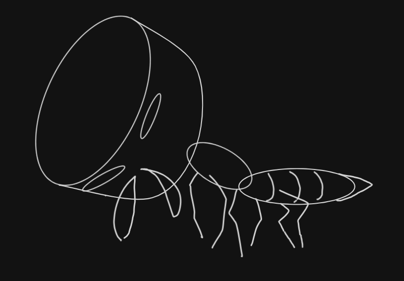

# Cephalote



Cephalote scans a source tree for weak and broken cryptography (MD5, DES, RC4,
undersized RSA keys, hardcoded keys, and so on) and tells you where it found
them. It's a single static binary with no runtime dependencies, Tree-sitter analysis
included, meant to drop onto a server or into CI without fuss.

## Install

### Arch Linux (AUR)

Cephalote is packaged on the AUR as [`cephalote`](https://aur.archlinux.org/packages/cephalote),
built from source against the tagged release. With an AUR helper:

```sh
yay -S cephalote      # or: paru -S cephalote
```

Or manually, with `makepkg`:

```sh
git clone https://aur.archlinux.org/cephalote.git
cd cephalote
makepkg -si
```

The AUR package is built with Tree-sitter like every other channel, linked
against the system libc rather than statically. It installs the binary to `/usr/bin/cephalote`, shell completions for bash, zsh,
and fish, and the annotated config plus scheduling guide under
`/usr/share/doc/cephalote/`.

To build the package straight from this repo instead of the AUR, run
`makepkg -si` in the repo root; the [`PKGBUILD`](./PKGBUILD) here is the same
one that's published.

### Other platforms

```sh
# Go toolchain
go install github.com/Smiduweorc/Cephalote/cmd/cephalote@latest

# Released binary (Linux/macOS, amd64/arm64)
curl -sSfL https://raw.githubusercontent.com/Smiduweorc/Cephalote/master/install.sh | sh

# Container (scratch image, static binary)
docker run --rm -v "$PWD:/src:ro" ghcr.io/smiduweorc/cephalote scan /src
```

`.deb`/`.rpm` packages and checksummed archives are attached to each
[GitHub Release](https://github.com/Smiduweorc/Cephalote/releases). Or build
locally with `make build` (see [Building](#building-tree-sitter-and-static-linking)).

Every channel above ships the Tree-sitter analyzer. The Linux release binaries
and the container image are fully static (musl), so they run on any Linux
with nothing installed. The macOS binaries link only against the system
`libSystem`, which macOS does not allow to be linked statically. `go install`
needs a C compiler on the machine, as any cgo package does; with
`CGO_ENABLED=0` it still builds, but without Tree-sitter.
`cephalote --version` says which you have: `(tree-sitter)`, or
`(no tree-sitter: built with CGO_ENABLED=0)`.

To run Cephalote continuously (on an interval or as a managed daemon) see
[docs/SCHEDULING.md](docs/SCHEDULING.md) for copy-pasteable Docker, Compose,
Kubernetes `CronJob`, and systemd examples.

## Usage

```sh
cephalote scan <dir> [flags]

  --format {text|json|sarif}   output format (default: text)
  --exit-code                  exit non-zero (1) when findings are present (CI gate)
  --include-unknown            run the regex fallback on unrecognized languages
  --min-confidence {low|high}  minimum confidence to report (default: low)
  --scheme <names|classes>     search for specific algorithms (see below)
  --config <file>              YAML config: excludes, overrides, custom schemes

cephalote schemes              list the algorithm catalog
```

Examples:

```sh
# Human-readable scan of the current tree
cephalote scan .

# SARIF for GitHub/GitLab code scanning, only high-confidence findings
cephalote scan . --format sarif --min-confidence high > results.sarif

# Gate a CI pipeline on any findings
cephalote scan . --exit-code
```

### Searching for specific algorithms

Beyond the default weak-crypto scan, `--scheme` turns Cephalote into a
crypto-aware search, useful for inventory and migration (e.g. "where do we
still use SHA-256?"). It accepts canonical names, aliases, or class selectors,
and reports matches of *any* strength, tagged with their security class.

```sh
cephalote schemes                          # list every known algorithm + class
cephalote scan . --scheme sha256           # find a specific algorithm
cephalote scan . --scheme sha-256,des3     # aliases + multiple, comma-separated
cephalote scan . --scheme weak             # all broken+weak schemes (broad net)
cephalote scan . --scheme all              # full crypto inventory
```

Class selectors: `all`, `weak` (broken+weak), `broken`, `legacy`, `contextual`,
`strong`. Search matches are regex-based and therefore low confidence.

## How it works

Cephalote detects the language of each file, then hands it to the most precise
analyzer it has for that language:

| Analyzer | Languages | Availability | Confidence |
|----------|-----------|--------------|------------|
| Go `go/ast` | Go | built-in | `high` |
| Tree-sitter | Python, JavaScript, TypeScript, Java, Kotlin, Scala, C#, Ruby, PHP, Rust, Swift, C, C++ | built-in | `high` |
| Regex over the scheme catalog | everything else | built-in | `low` |

The Go analyzer reads the actual syntax tree, so it is import-aware and looks at
values and structure: it flags `rsa.GenerateKey(rand.Reader, 1024)` but not
`4096`, resolves sizes given as constants or constant expressions
(`const bits = 1024`, `512*2`), follows renamed and versioned imports
(`math/rand/v2`), and spots hardcoded keys and static or zero
IVs. The regex analyzer scans every other language line by line against the
[algorithm catalog](internal/scheme/scheme.go), which is why those matches are
reported at low confidence.

The Tree-sitter analyzer works the same way across all thirteen languages. It
reads dotted names out of the tree, so one entry covers every way a name can be
qualified (`DES.new` matches `Crypto.Cipher.DES.new`), and it reads the
arguments, so it separates the real problem from the lookalike:
`Cipher.getInstance("DES/ECB/PKCS5Padding")` reports both DES and ECB while
`"AES/GCM/NoPadding"` reports nothing, and `Signature.getInstance("SHA1withRSA")`
is flagged where `"PBKDF2WithHmacSHA1"` is not. Key sizes are read as values, so
`new RSACryptoServiceProvider(1024)` is flagged and `4096` is not. Detections
that would be wrong for a given ecosystem are deliberately absent: Rust's
`rand::random` and Swift's `arc4random` are CSPRNG-backed, so neither is
reported as insecure randomness.

### Building (Tree-sitter and static linking)

Tree-sitter grammars are C, so Cephalote is a cgo program. The release
binaries are still single static files: they are linked statically against
musl, using [zig](https://ziglang.org) as a cross-compiling C toolchain.

```sh
make build      # static Linux binary for this machine's arch (needs zig)
make cross      # static linux/amd64 + linux/arm64 (needs zig)
make build-dev  # quick build with the host C compiler, dynamically linked
```

Without zig, any musl toolchain works the same way, e.g. on Alpine:

```sh
CGO_ENABLED=1 go build -ldflags "-linkmode external -extldflags -static" ./cmd/cephalote
```

`CGO_ENABLED=0` still compiles, with a stub in place of the analyzer, so the
thirteen Tree-sitter languages fall back to the low-confidence regex scan. No
shipped build does this, and `--version` marks such a binary.

A language is supported exactly when it appears in the registry in
[`internal/engine/ts/lang_specs.go`](internal/engine/ts/lang_specs.go). The
analyzer itself is language-agnostic, so adding one is a table entry: the
grammar, the handful of node types it uses for names and calls, and the
detections.

### Configuration & suppression

A YAML config (`--config`) adds excludes, rule overrides, and project-specific
detections, see [`cephalote.example.yaml`](cephalote.example.yaml):

```yaml
exclude: ["testdata/**", "**/*.min.js"]
rules:
  disable: [weak-hash-sha1, "scheme:cbc"]
  severity: { insecure-random: low }
custom_schemes:
  - id: internal-xor
    class: broken
    pattern: "(?i)\\bxor_encrypt\\b"
    remediation: "Use a vetted AEAD cipher."
```

Individual findings can be silenced inline (any language) with a comment:

```go
h := md5.New() // cephalote:ignore weak-hash-md5
secret := sha1.Sum(x) // cephalote:ignore       (bare form silences the line)
```

### Detections

**Go** (tier 1, high confidence, built in): weak hashes (MD5, SHA-1, MD4),
weak/broken ciphers (DES, 3DES, RC4, Blowfish), undersized RSA keys (<2048),
insecure randomness (`math/rand`, `math/rand/v2`), deprecated TLS versions, hardcoded keys, and
static/zero IVs.

**The thirteen Tree-sitter languages** (tier 2, high confidence, built in): weak hashes, weak/broken ciphers, ECB mode, undersized RSA keys,
insecure randomness, and deprecated TLS/SSL versions - read from the syntax
tree through each ecosystem's own API, so the same rule catches Java's
`Cipher.getInstance("DES/ECB/PKCS5Padding")`, Node's
`crypto.createCipheriv('des-ede3-cbc', ...)`, Ruby's `OpenSSL::Cipher.new`,
.NET's `new DESCryptoServiceProvider()`, PHP's `openssl_encrypt`, and
OpenSSL's `EVP_des_ede3_cbc()`. Hardcoded keys and static IVs are Go-only for
now.

**Every other language** (tier 3, low confidence): the full
[scheme catalog](internal/scheme/scheme.go): 50+ algorithms spanning hashes,
ciphers, modes, asymmetric schemes, KDFs, RNGs, and TLS versions. Run
`cephalote schemes` to list them.

## Exit codes

| Code | Meaning |
|------|---------|
| 0 | Success (no findings, or findings without `--exit-code`) |
| 1 | `--exit-code` set and findings were present |
| 2 | Operational error (bad flag, unreadable path, etc.) |

## Development

```sh
make build             # static binary with Tree-sitter (needs zig)
make build-dev         # host-toolchain build, dynamically linked
make test              # race + coverage, Tree-sitter included
make test-all          # also with CGO_ENABLED=0 (the stub)
make fmt vet           # formatting + go vet
make snapshot          # local goreleaser build (no publish)
make help              # list all targets
```

### Tests

`make test-all` also runs the suite with `CGO_ENABLED=0`, which compiles the
Tree-sitter stub instead of the analyzer; the routing tests assert the
regex fallback there.

Every package has tests. Beyond the per-package unit tests, a few are worth
knowing about because they are what keeps the moving parts honest:

- **Language fixtures** (`internal/engine/ts`): each of the thirteen languages
  has a weak fixture asserting exact per-rule counts *and* a clean fixture that
  must produce **zero** findings. The clean half is the important one - a
  crypto scanner that cries wolf on `AES/GCM/NoPadding` gets switched off.
- **Registry invariants**: every entry in the detection tables must name a rule
  the catalog knows (otherwise it panics at scan time rather than test time),
  and every language routed to tier 2 by `internal/lang` must be registered in
  the analyzer, so detection and routing cannot drift apart.
- **Output contracts** (`internal/report`): SARIF is machine-consumed, so the
  tests pin the things that break ingest silently - empty arrays that must not
  serialize as `null`, and every result referencing a declared rule.
- **Exit codes** (`cmd/cephalote`): run as a subprocess, since `--exit-code`
  calls `os.Exit`. CI gates on these, and 1 (findings) must never be confused
  with 2 (the tool failed).
- **Rule ID stability** (`internal/rules`): rule IDs appear in user config and
  in SARIF history, so renaming one has to be a deliberate act, not a typo.

CI runs gofmt, vet, race tests with coverage with and without cgo (Go
1.25/1.26), a static musl build for `linux/amd64` + `linux/arm64` that checks
the binaries are static and carry Tree-sitter, a GoReleaser config check, and `govulncheck`, on every
push and PR. Tagging `vX.Y.Z` triggers a GoReleaser release (static Linux binaries,
checksums, `.deb`/`.rpm`), and a macOS runner adds the darwin binaries.


> Latest Personal Notes:
> Prior to this branch existing, I was debating with myself if I even needed to make this have proper treesitter support for various languages. especially since the regex was actually pretty good at capturing cases.
> It did not also help that during my tests and experiments this increase in features led the binary to go up to almost 8 times (unstripped) the original size, which is not ideal for a something that calls itself CI friendly.
> However, the issues I found without using treesitter such as flagging the import and not the call site, or failure to flag in scenarios in `scheme.Scan` dangerous enought I felt the need to actually add it.
> I am sorry that there was no better way that I could have figured this out. If you have ideas let me know.