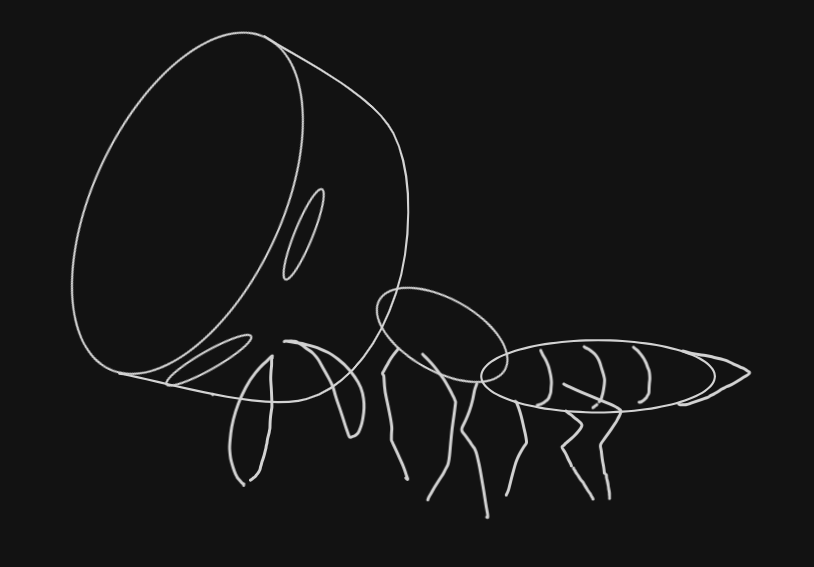

# Cephalote



Cephalote scans a source tree for weak and broken cryptography (MD5, DES, RC4,
undersized RSA keys, hardcoded keys) and reports where it found them. It is a
single binary with no runtime dependencies; with `--exit-code` it exits 1 on
findings, for CI.

## Install

### Arch Linux (AUR)

```sh
yay -S cephalote      # or: paru -S cephalote
```

Or with `makepkg`, from the [AUR](https://aur.archlinux.org/packages/cephalote)
or from this repo's [`PKGBUILD`](./PKGBUILD), which is the published one:

```sh
git clone https://aur.archlinux.org/cephalote.git
cd cephalote
makepkg -si
```

The AUR package includes Tree-sitter and links against the system libc. It
installs `/usr/bin/cephalote`, completions for bash, zsh and fish, and the
annotated config and scheduling guide under `/usr/share/doc/cephalote/`.

### Other platforms

```sh
# Go toolchain (Go 1.25+, and a C compiler for Tree-sitter)
go install github.com/Smiduweorc/Cephalote/cmd/cephalote@latest

# Released binary (Linux/macOS, amd64/arm64)
curl -sSfL https://raw.githubusercontent.com/Smiduweorc/Cephalote/master/install.sh | sh

# Container (scratch image, static binary)
docker run --rm -v "$PWD:/src:ro" ghcr.io/smiduweorc/cephalote scan /src
```

`.deb`/`.rpm` packages and checksummed archives are attached to each
[GitHub Release](https://github.com/Smiduweorc/Cephalote/releases).

Every channel ships the Tree-sitter analyzer. The Linux release binaries and
the container image are static (musl) and run on any Linux. The macOS binaries
link only against `libSystem`, which macOS does not allow to be linked
statically. `go install` with `CGO_ENABLED=0` still builds, but without
Tree-sitter. `cephalote --version` says which you have: `(tree-sitter)` or
`(no tree-sitter: built with CGO_ENABLED=0)`.

To run it on a schedule (Docker, Compose, Kubernetes `CronJob`, systemd), see
[docs/SCHEDULING.md](docs/SCHEDULING.md).

## Usage

```sh
cephalote scan <dir> [flags]

  --format {text|json|sarif}   output format (default: text)
  --exit-code                  exit non-zero (1) when findings are present (CI gate)
  --include-unknown            run the regex fallback on unrecognized languages
  --min-confidence {low|high}  minimum confidence to report (default: low)
  --scheme <names|classes>     search for specific algorithms (see below)
  --config <file>              YAML config: excludes, overrides, custom schemes

cephalote schemes              list the algorithm catalog
```

```sh
# Human-readable scan of the current tree
cephalote scan .

# SARIF for GitHub/GitLab code scanning, only high-confidence findings
cephalote scan . --format sarif --min-confidence high > results.sarif

# Gate a CI pipeline on any findings
cephalote scan . --exit-code
```

| Exit code | Meaning |
|------|---------|
| 0 | No findings, or findings without `--exit-code` |
| 1 | `--exit-code` set and findings were present |
| 2 | Operational error (bad flag, unreadable path) |

### Searching for specific algorithms

`--scheme` reports matches of any strength, tagged with their security class,
for inventory and migration work ("where do we still use SHA-256?"). It takes
canonical names, aliases or class selectors:

```sh
cephalote schemes                          # list every known algorithm + class
cephalote scan . --scheme sha256           # find a specific algorithm
cephalote scan . --scheme sha-256,des3     # aliases + multiple, comma-separated
cephalote scan . --scheme weak             # all broken+weak schemes
cephalote scan . --scheme all              # full crypto inventory
```

Class selectors: `all`, `weak` (broken+weak), `broken`, `legacy`, `contextual`,
`strong`. Search matches are regex-based and therefore low confidence.

## How it works

Cephalote detects each file's language and uses the most precise analyzer it
has for it:

| Analyzer | Languages | Confidence |
|----------|-----------|------------|
| Go `go/ast` | Go | `high` |
| Tree-sitter | Python, JavaScript, TypeScript, Java, Kotlin, Scala, C#, Ruby, PHP, Rust, Swift, C, C++ | `high` |
| Regex over the scheme catalog | everything else | `low` |

The Go analyzer is import-aware and reads values: it flags
`rsa.GenerateKey(rand.Reader, 1024)` but not `4096`, resolves constant sizes
(`const bits = 1024`, `512*2`), follows renamed and versioned imports
(`math/rand/v2`), and finds hardcoded keys and static or zero IVs.

The Tree-sitter analyzer reads dotted names, so one entry covers every
qualification (`DES.new` matches `Crypto.Cipher.DES.new`). It also reads
arguments:

| Flagged | Not flagged |
| --- | --- |
| `Cipher.getInstance("DES/ECB/PKCS5Padding")` (DES and ECB) | `Cipher.getInstance("AES/GCM/NoPadding")` |
| `Signature.getInstance("SHA1withRSA")` | `"PBKDF2WithHmacSHA1"` |
| `new RSACryptoServiceProvider(1024)` | `new RSACryptoServiceProvider(4096)` |

Rust's `rand::random` and Swift's `arc4random` are CSPRNG-backed and are not
reported as insecure randomness. Each Tree-sitter language has a clean test
fixture that must produce zero findings.

The regex analyzer checks every other language line by line against the
[algorithm catalog](internal/scheme/scheme.go), which is why those matches are
low confidence. A language gets Tree-sitter support by an entry in
[`internal/engine/ts/lang_specs.go`](internal/engine/ts/lang_specs.go): the
grammar, the node types for names and calls, and the detections.

### Detections

- Go (high confidence): weak hashes (MD5, SHA-1, MD4), weak or broken ciphers
  (DES, 3DES, RC4, Blowfish), RSA keys under 2048 bits, insecure randomness
  (`math/rand`, `math/rand/v2`), deprecated TLS versions, hardcoded keys, and
  static or zero IVs.
- The Tree-sitter languages (high confidence): weak hashes, weak or broken
  ciphers, ECB mode, undersized RSA keys, insecure randomness, and deprecated
  TLS/SSL versions, read through each ecosystem's own API: Java's
  `Cipher.getInstance`, Node's `crypto.createCipheriv('des-ede3-cbc', ...)`,
  Ruby's `OpenSSL::Cipher.new`, .NET's `new DESCryptoServiceProvider()`, PHP's
  `openssl_encrypt`, OpenSSL's `EVP_des_ede3_cbc()`. Hardcoded keys and static
  IVs are Go-only for now.
- Every other language (low confidence): the full
  [scheme catalog](internal/scheme/scheme.go), 50+ hashes, ciphers, modes,
  asymmetric schemes, KDFs, RNGs and TLS versions. `cephalote schemes` lists
  them.

## Configuration and suppression

A YAML config (`--config`) adds excludes, rule overrides and project-specific
detections; see [`cephalote.example.yaml`](cephalote.example.yaml):

```yaml
exclude: ["testdata/**", "**/*.min.js"]
rules:
  disable: [weak-hash-sha1, "scheme:cbc"]
  severity: { insecure-random: low }
custom_schemes:
  - id: internal-xor
    class: broken
    pattern: "(?i)\\bxor_encrypt\\b"
    remediation: "Use a vetted AEAD cipher."
```

Findings can be silenced inline, in any comment syntax (`//`, `#`, `--`, `;`,
`/* */`, `<!-- -->`), on the finding's line or the line above:

```go
h := md5.New() // cephalote:ignore weak-hash-md5
h, s := md5.New(), sha1.New() // cephalote:ignore weak-hash-md5, weak-hash-sha1 legacy interop
secret := sha1.Sum(x) // cephalote:ignore legacy checksum
```

The grammar is `cephalote:ignore [id ...] [reason]`. Ids are separated by
commas or spaces; each is a built-in rule id, `all`, or `scheme:<name>`. The
first word that is none of those starts the reason. With no ids, everything on
the line is silenced. So a misspelled rule id reads as a reason and silences
the whole line, while a `scheme:` id that matches no scheme silences nothing.

## Building from source

Tree-sitter grammars are C, so Cephalote is a cgo program. The release binaries
are linked statically against musl, with [zig](https://ziglang.org) as the
cross-compiling C toolchain (`make build`). Without zig, any musl toolchain
works, e.g. on Alpine:

```sh
CGO_ENABLED=1 go build -ldflags "-linkmode external -extldflags -static" ./cmd/cephalote
```

With `CGO_ENABLED=0` a stub replaces the analyzer and the Tree-sitter languages
fall back to the low-confidence regex scan. No shipped build does this.

## Why Tree-sitter

Before the Tree-sitter branch existed, I was debating with myself whether I
even needed proper Tree-sitter support for the various languages, especially
since the regex was actually pretty good at catching cases. It also didn't help
that in my tests and experiments the added features made the binary almost 8
times (unstripped) its original size, which is not ideal for something that
calls itself CI friendly. But the problems I found without Tree-sitter, such as
flagging the import and not the call site, or failing to flag some cases in
`scheme.Scan`, were dangerous enough that I felt I had to add it. I am sorry
that there was no better way I could figure out. If you have ideas, let me
know.

## License

MIT, see [LICENSE](./LICENSE).
